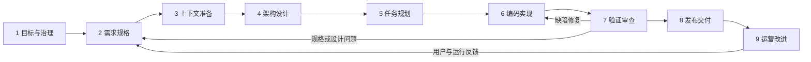

# AI 软件开发生命周期研究报告

面向读者：IT 软件工程师、技术负责人、研发效能与质量团队  
调研日期：2026 年 10 月 16 日  
研究方式：查阅厂商官方文档、官方源码仓库和标准机构资料；区分来源事实与本文提出的工程建议。

## 1. 核心结论与研究边界

**对软件工程师而言，AI 软件开发流程应覆盖从业务问题到线上反馈的完整闭环：目标与治理 → 需求规格 → 代码库与上下文准备 → 架构设计 → 任务规划 → 编码 → 验证审查 → 发布 → 运营改进。**

这九步是本文为便于落地而提出的综合划分，不是某个标准组织规定的“统一九步法”。所查资料采用不同粒度：AWS AI-DLC 使用三个宏观阶段，Kiro 将规格拆成需求、设计和任务，GitHub Agent 将部分工作落实为 Issue 到 Pull Request 的执行过程。它们可以组合使用，而不是必须选择其中一套覆盖所有问题。[AWS AI-DLC](https://aws.amazon.com/blogs/devops/ai-driven-development-life-cycle/)、[Kiro Specs](https://kiro.dev/docs/specs/)、[GitHub Agent 应用说明](https://docs.github.com/en/copilot/responsible-use/agents)

本文重点回答“**如何用 AI 开发软件**”，适用于普通 Web、后端、客户端和企业应用。第 7 节补充“**如何开发带 AI 能力的软件**”：后者还要管理数据、模型、提示词、评估集及模型输出质量，不能仅套用代码开发流程。Google 的 MLOps 文档解释了模型与数据验证、持续训练和监控等附加活动。[Google MLOps](https://docs.cloud.google.com/architecture/mlops-continuous-delivery-and-automation-pipelines-in-machine-learning)

需要先统一缩写：

| 名称 | 含义 | 本文中的位置 |
| --- | --- | --- |
| SDLC | Software Development Life Cycle，软件开发生命周期 | 从需求到维护的整体流程 |
| SDL | 在 Microsoft 官方体系中特指 Security Development Lifecycle，安全开发生命周期 | 安全活动贯穿开发全过程，不能理解为仅做发布前扫描 |
| AI-assisted SDLC | AI 辅助的软件开发生命周期 | 在现有流程中加入 AI 辅助分析、生成、测试和排障 |
| AI-DLC | AWS 提出的 AI-Driven Development Life Cycle | 一种强调 AI 执行与人类监督的具体方法论 |
| SDD | Spec-Driven Development，规格驱动开发 | 将需求、设计和任务变成可持久化、可检查的工程输入 |
| MLOps / LLMOps | 模型或大模型应用的开发运行实践 | 当交付的软件本身包含 AI 时，需要额外考虑 |

其中，SDL 的含义以 [Microsoft SDL 官方说明](https://www.microsoft.com/en-us/securityengineering/sdl/practices)为依据；其他条目是本文使用的工作定义，不代表这些概念存在统一、互斥的行业分类。

## 2. 业界有哪些代表性做法

### 2.0 可将传统六阶段 SDLC 作为团队的主骨架

用户提供的 [SDLC 六阶段文章](https://medium.com/@jilvanpinheiro/software-development-life-cycle-sdlc-phases-40d46afbe384)按顺序列出：**需求收集与分析 → 设计 → 实现/编码 → 测试 → 部署 → 维护**。作为团队沟通和流程建设的主骨架，这个划分清晰、可参考；尤其适合说明每一阶段都要有上游输入、阶段产物和下游验证。

不过，它发表于 2018 年，定位是传统 SDLC 的入门概述，并非当前 AI 开发的行业标准。文章的阶段顺序也不应被理解为一次性瀑布流程：敏捷团队会以小批量需求反复经过设计、编码、测试和发布，维护反馈再回到需求阶段。

若以它为主骨架，建议这样扩展为 AI 辅助研发流程：

| 传统六阶段 | AI 辅助后应补充的关键活动 | 主要输出与关卡 |
| --- | --- | --- |
| 需求收集与分析 | 明确目标、验收条件、非功能需求；让 AI 发现歧义，但由业务方确认规则；制定 AI 工具、数据与权限边界 | 已确认的规格、验收案例、风险与权限规则 |
| 设计 | 建立代码库上下文；设计架构、接口、数据、可观测性和威胁模型；AI 生成方案备选，人做取舍 | 设计说明、接口契约、ADR、测试与回退思路 |
| 实现/编码 | 将设计拆成小而可验证的任务；AI 在受控分支或隔离环境中修改代码、补测试和文档；持续集成 | 可审查的差异、测试、构建结果和变更说明 |
| 测试 | 以需求和独立案例验证，而不只验证 AI 自己生成的测试；加入集成、端到端、性能、安全和依赖检查 | 测试证据、审查记录、安全发现及处置 |
| 部署 | 制品可追踪；灰度或功能开关；配置和密钥隔离；设定回退与观察条件 | 部署记录、发布说明、监控与恢复预案 |
| 维护 | 监控业务、可靠性、安全和成本；用线上反馈更新规格、回归测试和 AI 上下文 | 事件复盘、缺陷任务、更新后的知识与测试资产 |

这六阶段与本报告的九步不是竞争关系：九步只是把传统流程中在 AI 时代容易被忽略的内容显式拆开。对应关系是：第 1–2 步细化“需求”，第 3–5 步细化“设计到实施准备”，第 6 步对应“编码”，第 7 步对应“测试与审查”，第 8 步对应“部署”，第 9 步对应“维护”。

因此，建设时建议保留六阶段作为对管理层和跨职能团队的统一语言，在每个阶段配置具体的 AI 输入、权限、工件与质量门禁。无需另起一套流程名称；团队已有 SDLC、Scrum 或 DevOps 流程时，更适合以这张映射表渐进补齐。

### 2.1 从现有 SDLC 出发，逐环节引入 AI

AWS Prescriptive Guidance 将生成式 AI 放进端到端工具链，并讨论 CI/CD、协作、重复任务自动化、知识管理、运维与持续改进。其定位是改进整个研发体验，而不局限于 IDE 代码补全。[AWS SDLC 指南](https://docs.aws.amazon.com/prescriptive-guidance/latest/strategy-accelerate-software-dev-lifecycle-gen-ai/introduction.html)、[AWS 最佳实践](https://docs.aws.amazon.com/prescriptive-guidance/latest/strategy-accelerate-software-dev-lifecycle-gen-ai/best-practices.html)

**本文建议：** 已有稳定敏捷和 CI/CD 的团队，可先在需求澄清、代码理解、测试设计和 PR 审查中试点，保留现有责任制，再用实际数据决定扩大范围。

### 2.2 AWS AI-DLC：三个宏观阶段

AWS 官方方法论划分为：

| 阶段 | 官方方法的核心内容 | 本文九步的对应关系 |
| --- | --- | --- |
| Inception，启动与细化 | 将业务意图转成需求、用户故事和工作单元；团队共同澄清和验证 | 目标、需求、上下文和部分规划设计 |
| Construction，构建 | 利用已验证上下文，形成架构、领域模型、代码与测试；团队处理技术决策 | 详细设计、任务规划、编码、验证 |
| Operations，运行 | 结合前期上下文辅助基础设施即代码和部署，由团队监督 | 发布、运行与反馈 |

AWS 将共同细化称为 Mob Elaboration，将共同构建称为 Mob Construction。这些是该方法的协作机制，不是全行业通用的必选仪式。[AWS AI-DLC 原文](https://aws.amazon.com/blogs/devops/ai-driven-development-life-cycle/)

其具体工作流还包含工作区识别、存量系统逆向理解、非功能需求与基础设施设计等阶段，并按需求和复杂度调整流程。因此，不能把“三阶段”理解成“只有三个动作”，也不必让小改动执行与大型项目相同的文档仪式。[AWS 工作流示例](https://aws.amazon.com/blogs/devops/building-with-ai-dlc-using-amazon-q-developer/)

落地时还需区分方法论和工具实现：本次查阅的开源编排器参考文档中，`classic` 配置的 Operation 仍为占位，其他配置则包含部署、可观测性等阶段。因此，应核对所选配置和版本，不能依据方法论中的 Operations 直接推断具体工具已提供完整运维自动化。[AI-DLC 编排器参考](https://github.com/awslabs/aidlc-workflows/blob/main/docs/reference/03-orchestrator.md)

### 2.3 Kiro 与规格驱动开发：把意图落到持久化工件

Kiro 官方规格结构包括：

- `requirements.md`，或缺陷场景下的 `bugfix.md`：描述需求、验收条件或缺陷分析。
- `design.md`：记录技术设计。
- `tasks.md`：记录可执行任务和进度。

其意义是使 AI 和人围绕可查看、可修改的工件协作；这些文件名是工具的实现约定，团队可使用自己的文档结构。[Kiro Specs](https://kiro.dev/docs/specs/)

**本文建议：** 对跨模块功能，先确认行为和边界，再细化设计与任务；对根因清晰的小缺陷，可用一份短说明承载这些信息。规格应随实现更新，否则会把过时要求持续输入给 AI。

GitHub 的开源 **Spec Kit** 提供另一种具体实现。本次查阅的官方参考流程为 `constitution → specify → clarify → plan → checklist → tasks → analyze → implement → converge`。其中 `clarify`、`checklist`、`analyze` 是可选质量关卡；`converge` 在实现之后检查代码与规格、计划、任务之间的遗漏，并追加待完成任务，再进入实现循环。特别要区分：`checklist` 检查的是需求质量，不能替代代码测试。[Spec Kit 官方参考](https://github.github.com/spec-kit/reference/agentic-sdd.html)

### 2.4 GitHub Agent：让任务通过分支、PR 和检查交付

GitHub 文档说明，其云端 Agent 可以响应分配的 Issue，创建分支、修改代码并打开 PR；AI 代码审查可产生反馈。官方同时要求理解能力限制、审查输出，并遵守安全编码实践。[GitHub Agent 应用说明](https://docs.github.com/en/copilot/responsible-use/agents)

**本文建议：** 委派单位应是“有清晰完成条件的任务”，交付单位应是“可审查的代码变更及验证证据”。团队需明确执行、审查、合并与生产发布的权限边界，避免把生成完成等同于验收完成。

### 2.5 Microsoft SDL 与 NIST SSDF：全过程的安全底座

Microsoft SDL 包含安全治理、设计审查与威胁建模、密码学、供应链、工程环境、安全测试、运行安全、监控响应和培训等实践。NIST SSDF 则提供可融入不同 SDLC 的安全开发建议。这两者应横向嵌入研发，而不是排在编码结束之后。[Microsoft SDL](https://www.microsoft.com/en-us/securityengineering/sdl/practices)、[NIST SSDF 1.1](https://csrc.nist.gov/pubs/sp/800/218/final)

**使用限制：** 厂商流程说明能够证明其推荐的方法和产品能力；不能单凭这些文档证明某方法对所有团队都有确定的提效比例。

## 3. 一套可落地的九步流程

**本节为本文综合建议。** 阶段名称、交付物和关卡用于帮助团队设计自己的流程，不是对任何厂商规范的逐条转述。依据包括前述 AI-DLC、规格工件、Agent 协作及安全实践；具体阈值须按业务风险决定。



图表示关注点之间的关系，不要求按瀑布式一次执行完毕。一个小功能可以在同一天完成多轮闭环；存量系统往往需要先理解代码，再补齐需求和设计。

### 第 1 步：定义业务目标与 AI 使用边界

**要回答：为什么做、如何判断有价值、允许 AI 做到什么程度？**

- 明确目标用户、业务问题、当前基线、预期结果和不做的范围。
- 评估工程可行性、预算、数据敏感度、关键系统依赖和失败后果。
- 明确可使用的 AI 工具与模型、可提供的代码和数据、允许执行的命令与外部访问范围。
- 设定角色：谁确认需求、谁对代码负责、谁批准高风险变更、谁负责线上服务。

**AI 可以做：** 汇总材料、梳理约束、形成问题清单和备选方案。  
**人必须负责：** 价值取舍、预算、风险接受与授权。  
**交付物：** 一页项目目标、范围与风险清单、AI 使用规则、初始指标。  
**通过条件：** 有业务负责人和工程负责人，成功条件可验证，敏感信息和操作权限边界明确。

### 第 2 步：将想法变成可验证的需求规格

**要回答：系统具体应该怎样表现？**

- 编写用户故事、业务流程、业务规则和验收条件。
- 覆盖正常路径、异常路径、边界条件、权限、重复请求和失败恢复。
- 明确非功能需求：性能、可用性、容量、可访问性、可观测性与数据保留。
- 将假设、待确认问题与已经确认的规则分开记录；为需求分配编号。

**AI 可以做：** 整理访谈、发现歧义、补充场景、生成验收条件草稿。  
**人必须负责：** 业务真实性与优先级，确认不能由 AI 猜测的规则。  
**交付物：** PRD 或轻量规格、验收案例、非功能需求清单。  
**通过条件：** 开发和测试能够据此判断行为对错，影响范围与主要例外已说明。

例如，“支持订单取消”不够；应说明哪些状态允许取消、谁有权限、如何处理重复请求，以及扣款和库存如何补偿。AI 提出的默认规则必须经过业务确认。

### 第 3 步：准备代码库、工程环境与任务上下文

**要回答：AI 是否理解现有系统，并能在正确环境中工作？**

- 理解项目结构、模块职责、接口、数据库、依赖、编码规范和已有设计决策。
- 对存量项目确认当前行为、调用链、已知缺陷和受影响模块。
- 跑通构建与相关测试，区分既有失败和本次变更新增失败。
- 准备任务所需的最小相关文档、版本信息、示例和测试数据。
- 建立隔离开发环境、受控凭据与权限，避免生产数据直接进入提示词或测试样本。

**AI 可以做：** 代码导航、依赖分析、影响面分析和文档草稿。  
**人必须负责：** 校核关键结论，确认上下文有效、权限适当。  
**交付物：** 系统概览、运行与测试说明、任务上下文包、基线结果。  
**通过条件：** 能复现运行环境，关键约束有依据，未知项明确标出。

上下文可以包括仓库规则文件，但不应只堆积历史聊天。需要记录来源和适用版本，并在需求、依赖或实现改变时更新。

### 第 4 步：完成架构、接口与安全设计

**要回答：怎样实现，为什么选择这个方案，风险在哪里？**

- 划分模块与领域边界，明确 API 契约、数据模型和系统交互。
- 设计状态转换、幂等、事务、超时、重试、并发与错误处理。
- 比较关键方案的复杂度、成本、性能、可维护性和迁移代价。
- 开展威胁建模，识别信任边界、认证授权、敏感数据流和供应链风险。
- 设计测试策略、日志指标、灰度方案、数据迁移与回退策略。

**AI 可以做：** 提出备选设计、生成图和接口草稿、寻找遗漏。  
**人必须负责：** 架构取舍、兼容性、关键安全控制与不可逆操作设计。  
**交付物：** 设计说明、接口契约、数据模型、必要的架构决策记录。  
**通过条件：** 关键设计有理由，风险有控制措施，能测试和运行，迁移可执行。

### 第 5 步：拆分可执行、可验证的任务

**要回答：AI 或工程师下一步具体做什么，如何知道做完？**

- 按可独立交付的行为切分任务，标明依赖与实施顺序。
- 为每个任务关联需求、修改范围、接口约束和验证方法。
- 明确不得修改的边界、停止条件和遇到歧义时的处理方式。
- 将高风险变更单独安排：认证、支付、数据迁移、公共 API 和基础设施权限等。
- 只对依赖清晰、冲突可控的任务并行执行，预留集成与审查能力。

**AI 可以做：** 形成任务清单、依赖图和实施计划。  
**人必须负责：** 调整粒度、顺序、资源和风险等级。  
**交付物：** 带完成条件的任务清单或 Issue、依赖关系、验证计划。  
**通过条件：** 每个任务都有输入、边界、责任人和可观察的完成证据。

### 第 6 步：AI 辅助编码与持续集成

**要回答：实现是否符合规格，并且保持改动可理解？**

- 在分支或隔离工作区中实施，保持变更范围集中。
- 让 AI 基于批准的任务改代码、补测试、更新接口和说明。
- 频繁运行相关构建、类型检查和测试，根据真实结果迭代。
- 检查依赖是否存在、版本是否兼容；避免未经确认引入新的包或架构模式。
- 对数据库、认证和权限等关键逻辑保留可解释的实现与审查记录。

**AI 可以做：** 生成和修改代码、补充测试、分析错误、提出修复。  
**人必须负责：** 理解关键代码与变更意图，处理边界变化和重要技术取舍。  
**交付物：** 代码差异、测试、必要文档、执行结果与未解决问题。  
**通过条件：** 相关检查实际运行，新增或改变的行为有验证，未发生无关范围扩张。

测试先行、结对开发或先实现再验证可以按场景选择；本文不把某一种编码节奏规定为所有任务的强制条件。

### 第 7 步：验证、代码审查与验收

**要回答：有什么证据证明系统满足要求，风险可接受？**

建议结合四类验证：

| 维度 | 典型内容 | 应形成的证据 |
| --- | --- | --- |
| 功能 | 单元、集成、接口、端到端、关键业务验收 | 对应需求的结果、失败详情与环境版本 |
| 可靠性与性能 | 并发、超时、重试、负载、恢复和兼容性 | 延迟、吞吐、错误、资源与恢复结果 |
| 安全与供应链 | 静态分析、依赖扫描、密钥检测、必要的动态或渗透测试 | 发现项、处置、例外与风险接受记录 |
| 可维护性 | 代码审查、复杂度、模块边界、测试有效性和文档一致性 | 审查意见及解决情况 |

**AI 可以做：** 补充测试思路、预审差异、分析失败、协助定位风险。  
**人必须负责：** 关键规则、测试预期、安全缺陷与验收判断。  
**交付物：** PR 审查、测试报告、安全结果、需求验收记录。  
**通过条件：** 必要检查通过，阻断问题解决，剩余风险有明确责任人处理。

特别注意：实现和测试若都源于同一个错误假设，测试通过也可能只是验证了错误行为。应从原始需求、接口契约、历史缺陷和独立验收案例构造验证依据。AI 声称“已完成”不能代替实际运行结果。

### 第 8 步：发布、迁移与可回退交付

**要回答：怎样把已验证变更安全地交给用户？**

- 通过 CI/CD 构建并发布可追踪版本，管理依赖和制品来源。
- 分离环境配置与密钥，确认生产环境及权限。
- 按风险采用灰度、金丝雀、蓝绿或功能开关。
- 对数据变更设计兼容窗口、备份、恢复及前向修复方案。
- 发布前明确指标阈值、观察窗口、暂停条件与值班责任人。

**AI 可以做：** 草拟流水线、基础设施代码、发布说明和检查清单。  
**人必须负责：** 组织规定的高风险发布决策及异常处置。  
**交付物：** 版本制品、部署记录、迁移脚本、恢复方案、发布说明。  
**通过条件：** 版本可追踪，关键监控生效，故障处置和恢复路径可执行。

无需把每次低风险发布都变成人工审批；可以在预先定义的权限与质量策略下自动执行。但不能默认代码回滚就能撤销所有数据变更。

### 第 9 步：运行监控、维护与流程改进

**要回答：上线后是否产生价值，哪些发现应进入下一轮开发？**

- 监控业务结果、服务目标、错误、延迟、成本与安全事件。
- 结合日志、指标和链路追踪进行故障定位；AI 建议应与运行证据核对。
- 管理依赖升级、漏洞修复、技术债和必要的下线计划。
- 将生产缺陷转成回归案例，将事件经验更新到规格、规则与运行手册。
- 观察 AI 节省的实现时间是否被审查、返工或上线故障抵消。

**AI 可以做：** 聚合告警、总结日志、提出根因假设和补丁草稿。  
**人必须负责：** 事件指挥、业务影响判断与高风险操作。  
**交付物：** 运行看板、事件复盘、维护任务、更新后的测试与上下文。  
**通过条件：** 新版本的线上表现可观察，责任明确，重要反馈形成可跟踪任务。

## 4. AI 引入后，流程需要增加哪些控制

以下是本文结合前述资料给出的实施建议，重点是让生成结果成为可信、可交接的工程成果。

| 关注点 | 建议控制 | 要避免的问题 |
| --- | --- | --- |
| 意图与上下文 | 持久化规格、规则、版本和设计决策；控制上下文时效 | AI 根据过时信息持续产出错误实现 |
| 行为权限 | 区分读取、改代码、执行命令、联网、合并和发布权限 | 一个任务获得超出需要的操作能力 |
| 外部输入 | 将 Issue、网页、文档和工具结果视作待核验输入 | 把内容中的指令误当成可信授权 |
| 生成依赖 | 核验包名、维护状态、许可和版本兼容性 | 不存在的依赖或不受控的供应链进入产品 |
| 验证独立性 | 使用需求与业务案例校验，保留人工抽查及确定性检查 | 模型用同一错误假设写实现和测试 |
| 过程证据 | 保留任务、版本、变更、检查结果和必要的执行记录 | 只知道 AI 给出了答案，无法复核执行过程 |
| 成本与退出 | 设定预算、重试或运行上限，提供中断和人工接管 | 无效反复迭代、成本增长或任务范围漂移 |

记录应遵守数据最小化原则，不意味着保存所有原始提示词、客户数据或密钥。对第三方 AI 服务，应根据具体产品配置核实数据流向和保留方式；不能仅依据“企业版”标签推断。

## 5. 如何衡量流程是否有效

以下为团队测量方案建议，不是厂商收益承诺。先取得可比任务的基线，再按任务类型、规模、风险和代码库熟悉程度比较；同时观察速度、质量和成本。

研究依据方面，DORA 的 2025 年报告将 AI 描述为既有组织能力的放大器；其 2026 年分析指出，较高 AI 采用率与交付吞吐提升和交付不稳定性提升同时相关。这里是研究观察到的相关关系，不能推断为 AI 在任何团队中都会造成同样结果。[DORA 2025 报告](https://dora.dev/research/2025/dora-report/)、[DORA：AI 使用中的权衡](https://dora.dev/insights/balancing-ai-tensions/)

DORA 的 AI 能力模型还强调七项支撑条件：清晰传达的 AI 立场、健康的数据生态、AI 可访问的内部数据、健全的版本控制、小批量工作、以用户为中心和高质量内部平台。这些条件提示团队把流程和工程底座与工具一起建设。[Google Cloud：DORA AI 能力模型](https://cloud.google.com/blog/products/ai-machine-learning/introducing-doras-inaugural-ai-capabilities-model)

| 维度 | 可采用指标 | 注意事项 |
| --- | --- | --- |
| 交付流动 | 需求到上线周期、PR 等待时间、部署频率 | 编码提速后，瓶颈可能转移到审查和集成 |
| 稳定性 | 变更失败率、回退/紧急修复、恢复时间 | 指标应明确失败与恢复的定义 |
| 产品质量 | 线上缺陷、关键路径通过率、安全问题与用户结果 | 测试覆盖率不能单独代表行为正确 |
| 人员投入 | 需求澄清、编码、审查和返工所需时间 | 应看总投入，而不是只记录生成用时 |
| AI 任务结果 | 验收成功率、人工接管率、失败原因 | 记录任务难度与完成条件，防止只挑简单任务 |
| 成本 | 工具订阅、推理、执行环境、审查返工和维护成本 | 建议关注每个验收通过任务的总成本 |
| 开发体验 | 认知负担、信任、满意度、知识掌握情况 | 不把生成代码量当成人员绩效 |

不建议把提示词数量、Token 消耗、生成代码行数或建议接受率当作主要成功指标。这些活动指标可以帮助诊断使用情况，但不足以证明业务价值。

## 6. 团队如何开始：建议的 30 天试点

这是一个可调整的试点安排，不是普遍适用的实施工期。

| 时间 | 主要行动 | 可检查产出 |
| --- | --- | --- |
| 第 1 周 | 选择边界清晰、环境可复现的任务；记录现有周期与缺陷；确定工具、权限和责任人 | 试点范围、基线和规则 |
| 第 2 周 | 打通需求、设计、任务、实现、PR 和测试闭环；形成简短模板 | 首批可验收变更及证据 |
| 第 3 周 | 扩展到若干可比任务；观察审查和返工；补齐上下文与质量关卡 | 失败原因、改进记录 |
| 第 4 周 | 对比总成本、交付周期、缺陷与开发体验；决定扩大、调整或收缩 | 试点评估和下一轮范围 |

可采用的最小任务模板：

```text
目标与关联需求：
当前行为 / 期望行为：
输入、输出与业务边界：
相关代码、接口和设计依据：
允许改动的范围与权限：
验收案例和验证方法：
风险、未知项与需要停止澄清的条件：
交付要求：代码差异、验证结果、文档和遗留问题。
```

对清晰的小修复可缩短文档；跨服务设计、权限变更和数据迁移应增加评审。流程强度应随风险变化，而不是随 AI 生成速度变化。

## 7. 如果交付的软件本身也包含 AI

例如智能客服、知识库问答、RAG、自动处理业务的 Agent。在九步 SDLC 之外，还需增加下列工作。Google 的 MLOps 文档强调数据和模型验证等活动；Microsoft 的生成式 AI 评估文档区分性能、质量与安全，并覆盖部署前验证和部署后监控。[Google MLOps](https://docs.cloud.google.com/architecture/mlops-continuous-delivery-and-automation-pipelines-in-machine-learning)、[Microsoft 评估文档](https://learn.microsoft.com/en-us/azure/ai-studio/how-to/evaluate-generative-ai-app)

下表是本文对 AI 应用交付的补充建议：

| 对应环节 | 需要增加的内容 | 典型工件或验证对象 |
| --- | --- | --- |
| 目标与需求 | 明确 AI 是否必要、可接受失败、拒答与人工接管 | 使用场景、风险及成功定义 |
| 数据与上下文 | 数据来源和授权、脱敏、标注质量、代表性、训练与评估隔离 | 数据说明、版本化评估集 |
| 方案设计 | 模型与供应商选择、提示词、检索、工具权限、延迟和成本 | 模型配置、提示词、检索和工具契约 |
| 实现与实验 | 先建简单基线，再比较提示词、检索、模型或微调 | 可复现实验、配置版本和比较结果 |
| 验证审查 | 任务成功、回答依据、检索质量、越权调用、提示注入与信息泄露 | 离线评估、对抗案例、业务抽检 |
| 发布交付 | 同时版本化代码、提示词、模型配置、索引和评估集 | 完整发布清单、灰度与降级方案 |
| 运营改进 | 质量变化、模型更新、知识时效、Token 成本和工具执行失败 | 质量看板、抽样审查、回归评估 |

调用现成模型 API 不等于必须训练模型；需要自训练或微调时，再加入数据处理、训练、模型登记与模型部署等工作。使用模型裁判时，应以业务人员标注的样本校准，并核验其与人工判断的一致性。

NIST SP 800-218A 是生成式 AI 与双重用途基础模型的 SSDF 社区配置文件，重点包含 AI 模型开发的安全实践。它需要与 SP 800-218 配合使用；不应被当成普通 AI 编码助手工作流的统一标准。[NIST SP 800-218A](https://nvlpubs.nist.gov/nistpubs/SpecialPublications/NIST.SP.800-218A.pdf)

## 8. 一手资料与证据范围

所有来源均于本次调研中查阅。网页和仓库会持续更新，实施具体命令和产品配置前应检查对应版本。

| 来源 | 本文使用范围 | 证据性质 |
| --- | --- | --- |
| [AWS：AI-Driven Development Life Cycle](https://aws.amazon.com/blogs/devops/ai-driven-development-life-cycle/) | 三阶段、人类监督、协作与持久化上下文 | 厂商方法论 |
| [AWS：Building with AI-DLC](https://aws.amazon.com/blogs/devops/building-with-ai-dlc-using-amazon-q-developer/) | 具体工作流与自适应阶段 | 官方实现示例 |
| [AWS：SDLC 生成式 AI 指南](https://docs.aws.amazon.com/prescriptive-guidance/latest/strategy-accelerate-software-dev-lifecycle-gen-ai/introduction.html) | 端到端应用范围 | 官方工程指南 |
| [AWS：最佳实践](https://docs.aws.amazon.com/prescriptive-guidance/latest/strategy-accelerate-software-dev-lifecycle-gen-ai/best-practices.html) | 工具链、协作、CI/CD、知识管理与运行反馈 | 官方工程建议 |
| [Kiro：Specs](https://kiro.dev/docs/specs/) | 需求、设计和任务工件 | 产品官方文档 |
| [GitHub：Spec Kit 流程参考](https://github.github.com/spec-kit/reference/agentic-sdd.html) | 规格驱动命令与实现后收敛 | 官方开源工具文档 |
| [GitHub：Copilot Agent 应用说明](https://docs.github.com/en/copilot/responsible-use/agents) | Issue 到 PR 的执行、能力限制及人工审查 | 产品能力与责任说明 |
| [AWS：开源编排器参考](https://github.com/awslabs/aidlc-workflows/blob/main/docs/reference/03-orchestrator.md) | 运维阶段的实现边界 | 官方开源实现文档 |
| [DORA：2025 研究报告](https://dora.dev/research/2025/dora-report/)、[2026 年权衡分析](https://dora.dev/insights/balancing-ai-tensions/) | 收益与工程能力、吞吐和不稳定性的关系 | 研究报告与第一方分析 |
| [Google Cloud：DORA AI 能力模型](https://cloud.google.com/blog/products/ai-machine-learning/introducing-doras-inaugural-ai-capabilities-model) | 支撑 AI 收益的七项能力 | 第一方研究模型说明 |
| [Microsoft：SDL Practices](https://www.microsoft.com/en-us/securityengineering/sdl/practices) | SDL 缩写与安全实践范围 | 官方安全实践 |
| [NIST：SP 800-218](https://csrc.nist.gov/pubs/sp/800/218/final) | 可融入 SDLC 的安全开发框架 | 标准机构建议文件 |
| [NIST：SP 800-218A](https://nvlpubs.nist.gov/nistpubs/SpecialPublications/NIST.SP.800-218A.pdf) | AI 模型开发安全补充及适用限制 | 标准机构社区配置文件 |
| [Google：MLOps](https://docs.cloud.google.com/architecture/mlops-continuous-delivery-and-automation-pipelines-in-machine-learning) | AI 产品附加的数据、模型与运行工作 | 官方架构指南 |
| [Microsoft：生成式 AI 评估](https://learn.microsoft.com/en-us/azure/ai-studio/how-to/evaluate-generative-ai-app) | AI 应用的部署前评估与运行后质量监测 | 产品官方文档 |
| [Jilvan Pinheiro：SDLC six phases](https://medium.com/@jilvanpinheiro/software-development-life-cycle-sdlc-phases-40d46afbe384) | 传统六阶段主骨架的参考来源 | 社区文章，2018 年；用于流程解释，不作为规范性依据 |

研究限制：本报告是代表性工程资料的综合研究，没有对所有厂商进行穷尽调查，也未开展团队现场测量。九步流程、质量关卡、指标方案和试点安排均为本文建议，不构成经过实验验证的普遍最优流程。
