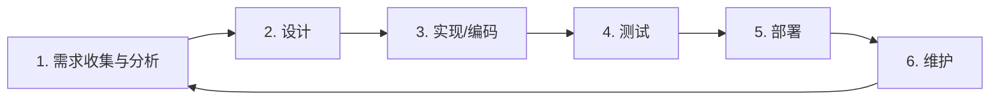

# AI 辅助 SDLC 六阶段总结报告

适用对象：软件研发团队  
版本：2026-10-16

## 1. 约定的流程

团队采用传统 SDLC 的六阶段作为统一研发语言：

流程是迭代闭环，而不是一次性瀑布。每个小批量需求应完整走过必要阶段；生产反馈、缺陷和用户需求从维护阶段回流到需求阶段。

AI 的角色是提升分析、生成、检索、验证和运维效率。业务取舍、架构关键决策、验收、生产风险接受和发布责任仍由明确的人负责。

## 2. 六阶段定义与执行要点

| 阶段 | 目标与主要工作 | AI 可协助的工作 | 阶段输出 | 进入下一阶段的条件 |
| --- | --- | --- | --- | --- |
| 1. 需求收集与分析 | 明确用户、业务目标、范围、业务规则、异常情况、非功能需求与验收标准 | 汇总访谈和资料；提出歧义、遗漏场景和验收案例草案 | 需求规格、验收标准、优先级、风险和待确认事项 | 业务负责人确认目标与规则；开发和测试可据此判断对错 |
| 2. 设计 | 确定架构、模块边界、接口、数据模型、安全、性能、可观测性、迁移与回退方案 | 代码库理解；生成方案备选、接口草稿、设计图和风险清单 | 设计说明、接口契约、数据变更方案、测试策略 | 关键取舍有明确理由；风险有控制方案；设计可测试、可运行 |
| 3. 实现/编码 | 将设计拆成小任务，在隔离分支或环境中开发并持续集成 | 修改代码、生成样板与测试、解释报错、更新文档 | 可审查代码差异、构建结果、测试和变更说明 | 相关构建与自动检查实际运行；改动范围可理解；无未解释的关键失败 |
| 4. 测试 | 验证实现满足原始需求，并检查性能、安全、兼容性和可维护性 | 提出边界和对抗案例；预审代码；辅助定位失败 | 测试结果、审查记录、安全扫描与缺陷处置 | 必要检查通过；阻断缺陷解决；剩余风险被明确接受并记录 |
| 5. 部署 | 将已验证版本安全交付给用户，并保证版本可追踪、可观测、可恢复 | 起草流水线、基础设施代码、发布说明和检查清单；分析发布信号 | 版本制品、部署记录、发布说明、监控和恢复预案 | 观察指标与值班责任明确；配置和密钥正确；回退或前向修复可执行 |
| 6. 维护 | 运行监控、事件响应、漏洞和依赖维护、成本治理、用户反馈与持续改进 | 汇总日志与告警；提出根因假设；生成修复和复盘草稿 | 运行看板、事件复盘、维护任务、回归案例和更新后的文档 | 重要反馈转为可追踪需求或缺陷，并更新测试、规格或团队规则 |

## 3. 贯穿六阶段的四项原则

1. **规格优先。** AI 接收的需求、设计和任务必须可查看、可更新、可追溯。不要只依赖聊天记录。
2. **小批量交付。** 将 AI 生成的工作切成易审查、易测试、易回退的变更，避免一次产生大范围改动。
3. **独立验证。** 测试依据来自原始需求、接口契约和业务案例。不能仅用 AI 为自身实现生成的测试来证明正确性。
4. **安全与责任内建。** 最小权限、代码与依赖扫描、密钥保护、审计记录和生产变更控制贯穿全部阶段；每项关键决策和线上操作有责任人。

## 4. 人与 AI 的职责边界

| AI 适合承担 | 人必须承担 |
| --- | --- |
| 起草、归纳、检索、代码和测试生成、静态检查、日志分析、方案对比 | 确认业务事实和优先级；批准需求与架构关键取舍；审查高风险变更；验收产品；决定上线、回退和风险接受 |

AI 的“任务完成”表示产生了待验证的结果，不表示需求已经验收或可以直接上线。

## 5. 最小工件集

每项常规功能至少应具有以下可追溯信息：

- 需求及验收标准。
- 必要的设计或接口变更说明。
- 可审查的代码变更和关联任务。
- 构建、测试和安全检查结果。
- 发布记录与线上监控链接。
- 线上缺陷或重要反馈的回流记录。

小型缺陷修复可以将这些内容浓缩在 Issue 和 Pull Request 中；涉及权限、资金、数据迁移、公共接口或多系统协作时，应使用独立设计和发布方案。

## 6. 建议的质量门禁

| 阶段结束 | 最小门禁 |
| --- | --- |
| 需求 | 验收条件和边界已确认，未知项可见 |
| 设计 | 接口、数据、安全与回退影响已评估 |
| 编码 | 构建、格式/类型检查和相关自动测试已运行 |
| 测试 | 功能、集成和高风险安全检查通过；代码审查完成 |
| 部署 | 制品与配置可追踪，监控与恢复路径就绪 |
| 维护 | 事件和用户反馈转化为后续需求、测试或改进项 |

门禁强度应随风险调整：低风险文案或界面改动可轻量执行；认证授权、支付、隐私数据、生产基础设施和数据迁移应提高审查与发布控制等级。

## 7. 衡量是否有效

评估 AI 引入效果时，同时观察交付速度、质量和成本：

- 从需求确认到上线的周期，以及 PR 审查等待时间。
- 部署频率、变更失败率、恢复时间和发布返工。
- 线上缺陷、关键业务验收通过率和用户反馈。
- 每个验收通过任务的总投入：实现、审查、返工、工具与推理成本。

不以生成代码行数、提示词数量或 AI 建议接受率作为主要绩效指标。这些只能说明活动量，不能证明软件交付了价值。

## 8. 采用结论

本团队以六阶段 SDLC 作为基础流程，在每个阶段引入受控的 AI 协作、可追溯工件与质量门禁。流程建设的重点不在于让 AI 替代阶段责任，而在于让 AI 缩短反馈周期、减少重复劳动，并使团队把时间投入到需求判断、设计取舍、验证和用户价值上。

## 参考资料

- [传统 SDLC 六阶段概述](https://medium.com/@jilvanpinheiro/software-development-life-cycle-sdlc-phases-40d46afbe384)
- [AWS：AI-Driven Development Life Cycle](https://aws.amazon.com/blogs/devops/ai-driven-development-life-cycle/)
- [GitHub Spec Kit：Agentic SDD](https://github.github.com/spec-kit/reference/agentic-sdd.html)
- [Microsoft Security Development Lifecycle](https://www.microsoft.com/en-us/securityengineering/sdl/practices)
- [NIST Secure Software Development Framework](https://csrc.nist.gov/pubs/sp/800/218/final)
- [DORA：AI 辅助软件开发中的权衡](https://dora.dev/insights/balancing-ai-tensions/)
